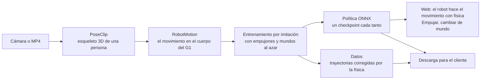

# Plan técnico del producto

- **Fecha:** 2026-10-24 · **Quién:** Pastor · **Estado:** propuesta; falta que la acepte el equipo.

Cómo se construye lo que promete el [pitch del producto](pitch/pitch-producto.md): el flujo completo, dónde corre cada parte, qué cambia en el contrato, qué falta construir en cada área y en qué orden, hasta el cierre del domingo a las 08:30. No asigna personas: el reparto lo decide el equipo.

## El flujo completo



| Paso | Qué hace | Dónde corre | Hoy |
| --- | --- | --- | --- |
| 1. Captura | La cámara graba desde que se enciende (hasta 30 s), o se sube un MP4 o un `.zip` (60 MB, 30 s por video) | Navegador (cámara) y Mac del servidor (videos) | Subida ✅. La cámara muestra la pose pero no graba |
| 2. Esqueleto | `PoseClip`: elige a la persona y saca sus 33 puntos 3D por cuadro | Navegador (MediaPipe) o Mac del servidor (YOLO + ByteTrack + MediaPipe) | ✅ |
| 3. Retargeting | `RobotMotion`: ángulos del G1 y recorrido de la pelvis por cuadro | Node en la Mac del servidor (para entrenar) y navegador (vista previa) | ✅ |
| 4. Entrenamiento | PPO con la recompensa de imitación (DeepMimic). Empujones y mundos al azar en cada episodio. Cada checkpoint se exporta a ONNX | Mac del servidor, CPU | `MimicEnv` existe y acepta cualquier clip; todavía no aprende |
| 5. Datos | Corre la política final en muchos mundos y guarda lo que hizo el robot | Mac del servidor | Por hacer |
| 6. Mostrar | MuJoCo WASM + onnxruntime-web: el robot sigue el movimiento con sus motores; se lo puede empujar y cambiar de mundo | Navegador | Solo la política de pie |
| 7. Entregar | Descargar la política y los datos | Servidor y web | Por hacer |

Entrenar un video toma decenas de minutos. Mientras tanto la web muestra las simulaciones precargadas y, a medida que salen, los checkpoints del robot del usuario: se lo ve mejorar.

## Dónde corre cada parte

| Pieza | Dónde | Cómo se despliega |
| --- | --- | --- |
| Web (`web/`, que usa `physics/` y `data/live`) | Navegador de quien abre la página; archivos estáticos en Vercel | `scripts/ship.sh` → espejo `Torpass/tridi` → Vercel (raíz `web/`) |
| API y colas (`data/server.py`) | La Mac del servidor | `data/serve.sh` con el túnel de Cloudflare; la web recibe la URL por `?api=` |
| Extracción de video (`data/`) | La misma Mac, con MPS (~40 s por video de 10 s) | Dentro del servidor, como hoy |
| Retargeting para entrenar (`physics/scripts/retarget-clip.mjs`) | La misma Mac, con Node | El servidor lo llama como subproceso |
| Entrenamiento, export y datos (`training/`) | La misma Mac, CPU | El servidor lo llama como subproceso con `uv`, **de a un entrenamiento** |
| Políticas y datos de cada video | Disco de la Mac (`TRIDI_DATA_DIR`) | Los sirve el mismo servidor |
| Precargadas | El repo: `data/clips/`, `physics/motions/`, `training/policies/` | Se empaquetan en el build de la web |

**Cuánto tarda y cuántos entran.** Con 64 robots en 8 procesos, una M2 hace 11.400 pasos por segundo: 20 M de pasos son unos 30 min. El presupuesto por video se fija cuando la caminata aprenda. La cola de entrenamiento tiene un tope (si está llena, la web lo dice) y muestra la posición y el tiempo estimado. Una segunda Mac entrena las precargadas durante la noche con los mismos comandos. Si la cola se alarga, se puede sumar como trabajador más adelante; no hace falta para el domingo.

## Lo que cambia en el contrato (primero, en un commit aparte)

En [`contrato.md`](contrato.md), antes del código que lo usa.

- **`POST /clips`**, cuerpo: un `PoseClip` (`source: "camera"`) → `201 { "clip_id" }`. Valida el esquema, 30 s como máximo y `valid_ratio` mínimo.
- **`POST /clips/{clip_id}/train`** → `202 { "train_id" }`, o `409` si la cola está llena. Sirve para clips de la cámara y de videos subidos.
- **`GET /train/{train_id}`**:

  ```jsonc
  {
    "state": "queued" | "running" | "done" | "failed",
    "position": 0,                         // entrenamientos antes que este
    "stage": "retarget" | "training" | "data",
    "steps": 3000000, "total_steps": 20000000,
    "followed_s": 4.2, "duration_s": 12.0, // cuánto del clip sigue el último checkpoint
    "checkpoints": [{ "steps": 3000000, "policy_id": "…" }],
    "eta_s": 1500,
    "error": null                          // en español si "failed"
  }
  ```

- **`GET /policies/{policy_id}.onnx`** y **`.json`**, **`GET /motions/{clip_id}.json`**, **`GET /datasets/{clip_id}.zip`**.
- **`policy.json`** suma `"task": "stand" | "mimic"`, `"motion"` (el `clip_id` que imita) y `"worlds"` (en qué mundos se entrenó).
- **Datos (`datasets/<clip_id>.zip`):** `meta.json` (clip, política, robot, 50 Hz y los parámetros de cada mundo) y `rollouts.npz`, por episodio: `t`, `qpos [T, 36]`, `qvel [T, 35]`, `ctrl [T, 29]`, fuerza de contacto de cada pie `[T, 2, 3]`, error de seguimiento, si se cayó y en qué mundo.
- **Mundos (`physics/worlds/<id>.json`):** fricción del piso, escena (plana o con piedras), viento, escala de masas, escala de fuerza de los motores y empujones, cada uno como rango `[mín, máx]`. El entrenamiento sortea dentro de cada rango en cada episodio; la web muestra el valor del medio. Un solo archivo para los dos, así lo que se ve es lo que se entrenó.

## Qué falta construir

Por área. Cada tarea dice qué necesita antes; se marca `[ ]` pendiente, `[~]` en curso o `[x]` lista.

### Entrenamiento (`training/`)

- [~] **ENT-1. Que la imitación aprenda la caminata.** Lo más importante: sin esto no hay producto. En este orden:
  - [x] Reproducir la referencia con la pelvis sostenida (sin red y sin que pueda caerse) y medir si los motores siguen los ángulos y si los pies apoyan sin hundirse ni flotar: `training/diagnose_reference.py`. Sin sostenerla, caerse es lo esperado (sin red tampoco se sostiene de pie), así que la fila "sin política" de `evaluate_walk.py` no dice si la referencia sirve. Encontró dos errores, ya arreglados en `imitate.Motion`: suavizar la altura de la pelvis dejaba pies hundidos o en el aire, y los objetivos de los pies no coincidían con la pose. Queda uno: caderas y tobillos van 60 a 100 ms detrás de la referencia, y la observación la muestra solo 20 ms adelante.
  - [x] Entrenar con la referencia limpia y comparar con `walk-v2`: igual (0,93 s contra 0,9 s a los 5 M pasos). La red aprende a no caerse, pero los episodios se cortan porque se aleja del recorrido: no da los pasos para avanzar con la referencia.
  - [x] Sumar a la observación la referencia a 0,1 y 0,25 s (`obs_dim` 190) para que la red pueda anticiparse al retraso de los motores. Ayuda poco: 1,23 s contra 1,03 s a los 10 M pasos, y el robot sigue quedándose atrás (la referencia va 0,5 m adelante cuando se corta).
  - Premiar que la pelvis avance a la velocidad de la referencia: hoy la recompensa no lo pide, y la de posición casi no da nada a 0,5 m.
  - Probar un movimiento en el lugar (jumping jacks, brazos), que no tiene recorrido del que alejarse.
  - Reproducir la referencia más lenta al principio y acelerarla a medida que aprende.
  - Probar con 2 a 3 s de un ciclo de paso en vez del clip entero.
  - Los empujones, recién cuando camine.
- [ ] **ENT-2. Cualquier clip.** `ppo.py --task mimic --motion <ruta>`: `MimicEnv` carga el `RobotMotion` de cualquier ruta, no solo de `physics/motions/`. `walk` queda como alias.
- [ ] **ENT-3. Empujones y mundos en la imitación.** Prender los empujones de `MimicEnv` (hoy apagados) y sortear un mundo por episodio. *Necesita:* ENT-1 y SIM-3.
- [ ] **ENT-4. Un ONNX por checkpoint.** Exportar cada checkpoint al guardarlo (no solo al final), con `task`, `motion` y `worlds` en `policy.json`, y medir `followed_s` con la evaluación: es lo que la web muestra mientras entrena. *Necesita:* el contrato.
- [ ] **ENT-5. Los datos.** `training/rollout.py`: la política final en N episodios por mundo, guardada con el formato del contrato. *Necesita:* ENT-3.

### Simulador (`physics/`)

- [ ] **SIM-1. El navegador corre políticas de imitación.** En `src/policy.js`: la referencia en JS (la misma limpieza, muestreo y velocidades que `imitate.Motion`), la observación de 126 números y el arranque en la primera pose del clip con los pies en el piso (como `reset_at` y `_touch_ground`). Interfaz: `view.loadPolicy(onnx, json, { motion })`; `clipTime()` sigue sincronizando el esqueleto. *Necesita:* los campos nuevos de `policy.json`.
- [ ] **SIM-2. Igual que en Python.** Un archivo de prueba generado en Python (observaciones y `ctrl` de N pasos) que `npm run check` compara con lo que arma el navegador. Si la observación difiere, el robot se cae aunque todo "corra". *Necesita:* SIM-1.
- [~] **SIM-3. Los mundos.** Hecho en `physics/` y en la web (selector en Simulaciones), con el formato del contrato; falta el lector en Python para `training/` (ENT-3). `physics/worlds/` con plano, piedras, resbaloso y viento; la escena con terreno de piedras (un mapa de alturas de pocos centímetros, para que la altura de la pelvis de la referencia siga valiendo), y `view.setWorld(id)`, que cambia fricción, viento, masas y fuerza de los motores. El lector en Python para `training/env.py` va en un commit aparte, porque toca otra carpeta.
- [ ] **SIM-4. `--out` en el retargeting.** Para que el servidor escriba los `RobotMotion` de los usuarios en su carpeta de datos y no en `physics/motions/`, que está versionada.
- [ ] **SIM-5. Robustez medida.** Correr una política en mundos que no vio al entrenar (más pesado, motores más débiles, piso más resbaloso) y contar cuántos episodios aguanta. Es el número honesto para el pitch y va en `meta.json` de los datos. *Necesita:* ENT-3.

### Servidor (`data/`)

- [ ] **SRV-1. Clips de la cámara.** `POST /clips`, con la validación del contrato. *Necesita:* el contrato.
- [ ] **SRV-2. La cola de entrenamiento.** Aparte de la de videos, de a un entrenamiento y con tope. Encadena `retarget → training → data` como subprocesos (`node physics/scripts/retarget-clip.mjs --out …`, `uv run … training.ppo`, `training.export`, `training.rollout`) y reporta el progreso de `GET /train/{train_id}`. *Necesita:* ENT-2, ENT-4 y SIM-4.
- [ ] **SRV-3. Servir lo entrenado.** Los `GET` de políticas, movimientos y datos. *Necesita:* SRV-2.

### Web (`web/`)

- [~] **WEB-1. La cámara graba al encenderse.** Hecho grabar, el contador, Parar y la galería; falta mandarlo (SRV-1). `startRecording()` al encender (ya existe en `data/live`), contador hasta 30 s y botón Parar. El `PoseClip` aparece en la galería (marioneta) y se manda con `POST /clips`. *Necesita:* SRV-1 para mandarlo; grabar y mostrarlo, no.
- [ ] **WEB-2. Entrenar.** Botón "Entrenar al robot con este video" en clips de cámara y subidos. Etapa "Entrenando": posición en la cola, porcentaje, tiempo estimado y el robot del usuario en cada checkpoint nuevo (carga el ONNX en cuanto aparece). Mientras tanto, las precargadas. *Necesita:* SRV-2, SRV-3 y SIM-1.
- [ ] **WEB-3. Resultado.** El robot con su política (con física), Empujar, un selector de mundos (`view.setWorld`) y botones para descargar la política y los datos. *Necesita:* WEB-2 y SIM-3.
- [ ] **WEB-4. Precargadas con imitación.** Cada entrada del manifiesto suma `policy`, y la galería las muestra con su robot entrenado. *Necesita:* SIM-1 y las precargadas entrenadas.

### Pitch y entrega (`docs/`)

- [ ] **DOC-1. El guion de 3 minutos** a partir del pitch del producto, cronometrado con `pitch/tools/cronometro.py`.
- [ ] **DOC-2. Los videos de las precargadas:** caminar, correr, jumping jacks y bailar, de 30 s como máximo, con el cuerpo entero en cuadro y caminando de perfil. Tienen que salir por el mismo flujo que el de un usuario.
- [ ] **DOC-3. Video de respaldo de la demo y `README.md`.**

## Orden

| Cuándo | Qué |
| --- | --- |
| **Sábado hasta las 12:00** | El contrato. **ENT-1** (lo que más importa), ENT-2, SIM-1, SIM-2, SIM-4, WEB-1, DOC-1 |
| **Sábado de 12:00 a 20:00** | ENT-3, ENT-4, SIM-3, SRV-1, SRV-2, SRV-3, WEB-2, WEB-3 |
| **Sábado de 20:00 a domingo 04:00** | DOC-2: grabar los videos y entrenar las precargadas en dos Macs durante la noche. ENT-5, SIM-5, WEB-4. Probar todo desde un celular. DOC-3 |
| **Domingo de 04:00 a 08:30** | Nada nuevo: arreglos, `README.md`, `scripts/check-submission.sh` y el último ship |

A las 12:00 se mira ENT-1. Si la caminata no aprende, se achica antes de seguir: un clip más corto o un movimiento en el lugar (jumping jacks). El resto del flujo no cambia.

## Las precargadas

Salen del mismo flujo, no se hacen a mano: video → `PoseClip` → `RobotMotion` → entrenamiento → política. Se versionan el clip, el movimiento y la política (y los datos, si pesan pocos MB). No son movimientos preentrenados: son ejemplos de lo que sale para cualquier video.

## Después del hackathon (prometido en el pitch)

- **Esquivar obstáculos:** que el robot vea su entorno (un mapa de alturas alrededor), una orden de a dónde ir y entrenar con tarea + estilo: la tarea premia llegar sin chocar y el video premia moverse como humano (AMP, Peng et al., 2021).
- **Robot real:** modelo de los motores y sus retardos, solo los sensores que tiene el robot (estimar la altura de la pelvis en vez de leerla) y probarlo en un G1.
- **Entrenar más rápido:** MuJoCo en GPU (MJX; Menagerie ya trae `g1_mjx.xml`), para bajar de media hora por video a minutos.
- **Una política para muchos movimientos**, y los datos en un formato estándar para los clientes.
- **Empresas de hardware:** el mismo simulador con el modelo de su máquina.
